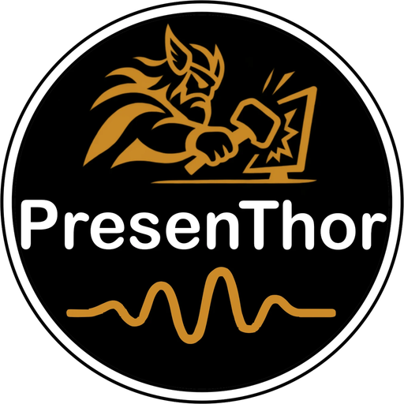

<p align="center"></p>

# PresenThor

Logiciel de diffusion pour événements : il gère sur grand écran les présentations PowerPoint, vidéos, images, visioconférences, sondages et questions du public. Il pilote plusieurs sorties vidéo et ne coupe pas l'image entre deux médias.

Il fonctionne de trois façons, à partir du même code :

| Mode | Usage |
|---|---|
| **App Mac / PC** (Electron) | Régie sur l'ordinateur de diffusion. Chaque sortie s'ouvre en plein écran sur l'écran physique choisi. |
| **Réseau local** | Les autres appareils du réseau (téléphones, PC d'écrans déportés) se connectent à la régie. |
| **En ligne** | Serveur hébergé (Docker). Le public vote depuis Internet. Accès régie protégé par code PIN. |

## Fonctions

L'interface fonctionne comme une table de mixage vidéo : une **grille de calques (lignes) et de colonnes**. Chaque case contient un clip, et tous les calques actifs sont mélangés en temps réel.

- **Grille de clips** :
  - un clic sur une vignette déclenche le clip sur son calque ;
  - un clic sur un en-tête de colonne déclenche toute la colonne (les calques sans clip dans la colonne sont vidés) ;
  - touches 1 à 9 pour les colonnes ;
  - glisser-déposer pour déplacer (Alt pour copier) ;
  - clic droit pour les options.
- **Calques** (X vider, B masquer, S solo) : opacité, mode de fusion (normal, ajout, écran, produit, incrustation…), volume, transition cut ou fondu, position / échelle / rotation, effets, masques (ovale, cercle, coins arrondis, losange).
- **Clips** : présentations PowerPoint / Keynote / PDF, vidéos, images, sons, pages web / visio, caméras et cartes d'acquisition, sources NDI, textes, couleurs, QR codes, sondages, questions du public, scènes. Chaque clip a ses propres réglages :
  - fin de lecture : boucle, une fois, clip suivant, ou vider le calque ;
  - vitesse et volume ;
  - cadrage, position, effets et masque.
- **Effets** (temps réel) : luminosité, contraste, saturation, teinte, flou, noir & blanc, sépia, négatif, miroirs. Ils se glissent sur un calque ou un clip.
- **Télécommande de présentation** : elle fait avancer la présentation à l'écran. Après la dernière diapo (ou sans présentation), elle passe à la colonne suivante.
- **Sans coupure** : chaque clip est préparé en arrière-plan avant d'être affiché, et la diapositive suivante est préchargée.
- **PowerPoint** :
  - **images + vidéos intégrées** (fonctionne partout). Conversion via LibreOffice, ou à défaut PowerPoint (Windows / Mac) ou Keynote (Mac) ;
  - **PowerPoint natif** (app Mac / PC avec PowerPoint) : animations et transitions conservées.
- **Sorties** : chaque sortie affiche au choix :
  - la composition ;
  - la composition sans bandeau ;
  - un calque seul ;
  - le retour présentateur (écran, diapo suivante, notes, chrono, messages) ;
  - le multiview (sortie + un moniteur par calque) ;
  - un clip fixe.

  Chaque sortie peut aussi utiliser le mapping (déformation 4 coins, fondu de bord, mire) et être publiée en NDI.
- **Plein écran des sorties** (app Mac / PC) : **Échap** ou double-clic dans la sortie pour revenir en fenêtre, **Ctrl+Alt+F** (⌘+Alt+F) depuis n'importe où, ou bouton dans l'onglet *Sorties*.
- **Public** : sondages en direct (QR code, résultats animés), nuage de mots, questions modérées.
- **Direct** : message au présentateur, bandeau nom / fonction, chronomètre, écran noir.
- **Télécommande smartphone** (`/remote/`) : suivant / précédent, notes, chrono.

## Démarrer

```bash
npm install
```

App desktop :

```bash
npm run desktop
```

Mode serveur (réseau local ou en ligne) :

```bash
npm start
```

Ouvrez ensuite `http://localhost:4517/control/` pour la régie. Sur chaque ordinateur relié à un écran, ouvrez `http://<ip>:4517/output/` puis choisissez la sortie.

**Protéger la régie en ligne :**

```bash
PRESENTHOR_PIN=1234 npm start
```

Pour la conversion PowerPoint, installez [LibreOffice](https://www.libreoffice.org/). Sans LibreOffice, importez vos présentations au format PDF.

### Installeurs Mac / Windows

```bash
npm run dist:mac
```

```bash
npm run dist:win
```

Les installeurs sont produits dans `dist/`, avec l'icône PresenThor (`build/icon.png`, générée depuis `build/logo-source.webp`). Le `.dmg` doit être construit sur un Mac. Le `.exe` se construit de préférence sur Windows.

### En ligne avec Docker

```bash
docker build -t presenthor .
```

```bash
docker run -p 4517:4517 -v presenthor-data:/data -e PRESENTHOR_PIN=1234 presenthor
```

Placez un reverse-proxy HTTPS devant (WebSocket sur `/ws`). Renseignez l'URL publique dans *Réglages* : le QR code de vote pointera dessus.

### Prérequis selon les fonctions

| Fonction | Prérequis |
|---|---|
| Conversion PowerPoint en images | LibreOffice, ou à défaut PowerPoint (Windows / Mac) ou Keynote (Mac) ; sinon importer en PDF |
| PowerPoint natif (animations) | App Mac/PC + Microsoft PowerPoint installé sur la même machine. Mac : autoriser l'app dans *Confidentialité → Automatisation* et *Enregistrement de l'écran* |
| NDI | App Mac/PC. Le module NDI est compilé à l'installation (`npm install`) : Xcode Command Line Tools sur Mac, « Build Tools for Visual Studio » sur Windows |

Sans PowerPoint ou hors de l'app desktop, une présentation réglée en « natif » retombe automatiquement sur le rendu images.

## Raccourcis régie

| Touche | Action |
|---|---|
| 1 … 9 | Déclencher la colonne |
| → / PageDown | Diapo suivante (puis colonne suivante) |
| ← / PageUp | Diapo précédente |
| B | Écran noir |
| Suppr | Retirer le clip sélectionné de sa case |
| Ctrl+Alt+F (⌘+Alt+F) | Sortir toutes les sorties du plein écran |

## Architecture

```
server/        Serveur Node (Express + WebSocket) : état du show, médias, conversion
  store.js     État du show, actions, sondages, Q&R
  comp.js      Composition : calques × colonnes, déclenchement, lecture, télécommande
  media.js     Import, conversion PowerPoint→PDF, extraction des notes et des vidéos
  ndi.js       Découverte des sources NDI
public/
  shared/      Moteur de rendu sans coupure, composition (calques mélangés), mapping, client temps réel
  control/     Régie
  output/      Sorties (programme, présentateur, multiview…)
  remote/      Télécommande smartphone
  vote/        Page publique (votes, questions)
electron/      App Mac/PC : serveur embarqué, sorties plein écran par écran physique,
               réception NDI (preload), publication NDI (ndi-out), pilote PowerPoint (ppt)
test/          Tests de la logique de régie et du mapping (npm test)
```

NDI® est une marque déposée de Vizrt NDI AB.
